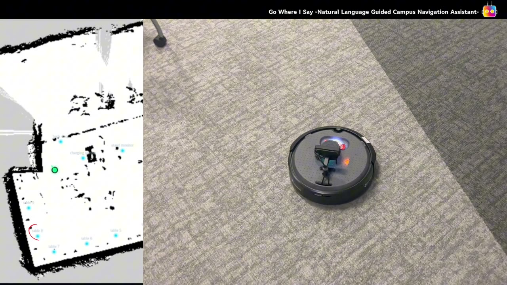

# LLM-Guided Campus Navigation on TurtleBot 4

Speak or type a request like "take me to desk 1" or "visit tables 3, 5, and 7", and a TurtleBot 4 plans and drives the route on its own. An LLM planner turns natural language into tool calls, a hand-annotated semantic map resolves the destination, and ROS 2 Nav2 with AMCL localization does the driving, with automatic recovery from the failure modes that real hardware throws at you (clock drift, AMCL particle collapse, flaky DDS discovery).

Built as the final project for **CS5335 Robotic Science and Systems** at Northeastern University (Spring 2026).

[](https://enpingsu.io/img/turtlebot-demo.mp4)

**[Watch the full demo video (4.5 min)](https://enpingsu.io/img/turtlebot-demo.mp4)**

## How it works

- **LLM planner** (`campus_nav_llm/llm_planner_node.py`): a regex fast path handles simple commands ("go to X", "stop", "where am I") without an API call; everything else runs a tool-calling loop against Claude via an OpenAI-compatible API. Eight tools: `navigate_to`, `navigate_route` (multi-stop), `get_robot_position`, `speak`, `cancel_navigation`, `clear_costmap`, `get_navigation_status`, `relocalize`. Calls are retried with exponential backoff, can be cancelled mid-loop, and conversation history is trimmed without ever splitting a tool call from its result.
- **Task executor**: runs inside the planner process (to avoid DDS message loss), routes tool calls to Nav2 through a thread-safe navigator, and enforces pre-flight safety checks (goal inside the map, AMCL covariance below threshold).
- **Localization recovery**: an AMCL watchdog republishes the last good pose and re-syncs clocks when `/amcl_pose` goes stale, and a `relocalize` tool spins the robot to re-disperse the particle cloud.
- **Lifecycle activator**: replaces Nav2's `lifecycle_manager` (which fails under FastDDS Discovery Server) with one persistent node; bring-up takes about 35 s instead of 90 to 180 s.
- **Semantic map**: 13 labeled locations plus aliases ("entrance" -> `front_door`), validated against the occupancy grid by `validate_coordinates.py`.
- **Mission-control dashboard**: live pose and AMCL covariance on the map, click-to-navigate, voice input, pre-flight diagnostics with auto-fix, dock/undock, and log viewers.
- **Deployment**: `deploy.sh` is a nine-step bring-up pipeline (clock sync, lifecycle activation, initial pose) that can also be driven from the dashboard.

## Testing

114 tests across 8 files, all runnable without ROS thanks to pure-Python `*Core` classes behind thin ROS node shells:

```bash
cd campus_guide_bot/campus_nav_llm
pytest
```

`pytest.ini` emits JUnit XML (`test-results/junit.xml`) for CI.

## Stack

ROS 2 Humble, Nav2, AMCL, SLAM, FastDDS Discovery Server, TurtleBot 4 (Raspberry Pi 4 + Create 3), Python, FastAPI + WebSockets, OpenAI Python SDK (via OpenRouter, Claude Sonnet), pytest.

## Running it

See [`STARTUP_GUIDE.md`](STARTUP_GUIDE.md). Robot connection settings live in `config.yaml`; set the robot's SSH password through the `ROBOT_SSH_PASS` environment variable rather than committing it.

### Access and safety notes

- The dashboard (`127.0.0.1:8080`) and the speech UI (`127.0.0.1:8888` by default) only accept requests and WebSocket connections from their own page. Other websites open in the same browser, and DNS-rebinding tricks, get `403`. The speech UI can still listen more widely with `--host 0.0.0.0`; only do that on a trusted network.
- SSH to the robot uses `StrictHostKeyChecking=accept-new`: the robot's host key is pinned the first time, and a different key is refused. After reflashing the robot, clear the old key once with `ssh-keygen -R <robot-ip>`.
- Location names may use letters, numbers, spaces and `. , ' ( ) & / -`. In `config.yaml` they become keys of `[A-Za-z0-9_]`, and `deploy.sh` refuses a `robot.namespace`, IP, user or pose that isn't a plain value.
- `python3 -m unittest discover -s tests` checks the origin rules.

## Team and credits

Built by a five-person team: **Tong Wu, En-Ping Su, Jingsi Zhang, Dayu Wang, and Xuetao Li.**

**En-Ping Su's contributions:** the LLM planner and tool-calling loop; its resilience logic (retries with exponential backoff, mid-loop cancellation, health-status aggregation, conversation trimming); CI/CD, QA, and end-to-end testing including debugging across the speech, LLM, and navigation stack; and SLAM mapping and robot localization.

This repository is a cleaned public snapshot of the team's original private repository (development history, build artifacts, and course submission documents removed).

### Third-party code

`campus_guide_bot/external/ros_llm/` is adapted from [ROS-LLM by Auromix](https://github.com/Auromix/ROS-LLM), licensed under the Apache License 2.0 (see its `LICENSE` file).
